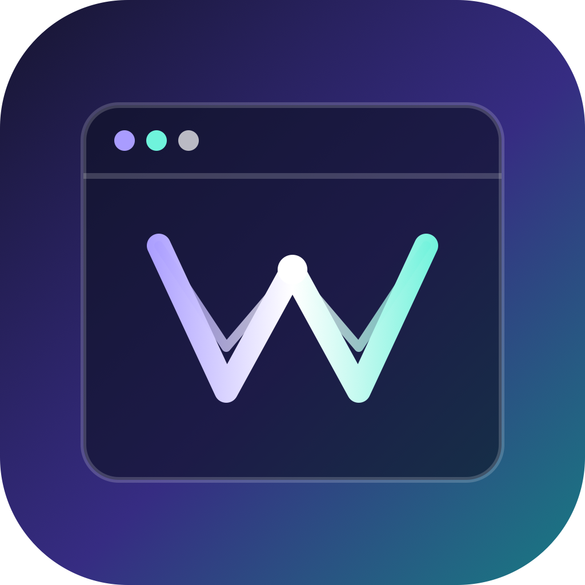

<p align="center"></p>

# WebCraft plugin

Portable skills for evidence-driven website recreation and frontend review.

Install from Claude Code:

```text
/plugin install webcraft --marketplace saikou-gh/webcraft-skills
```

Install from the Codex CLI:

```bash
codex plugin marketplace add saikou-gh/webcraft-skills
codex plugin add webcraft@webcraft-skills
```

## Included skills

- `web-replication`
- `asset-inspector`
- `animation-capture`
- `web-replica-3d`
- `web-game-replication`
- `reviewing-web-craft`
- `web-replica-review`

Ask naturally after restarting the agent:

```text
Recreate this landing page in the current repository and verify its responsive behavior.
Inventory the assets and rendering libraries used by this site.
Compare the reference and replica animation timing.
Review this frontend for craft quality and accessibility.
```

The plugin has no hooks, telemetry, accounts, or private service dependencies. Browser helper dependencies are installed only when a user chooses to run those helpers. The helpers require Node.js 22.12 or newer; follow the `npm ci` setup in their skill instructions.

Full documentation: https://github.com/saikou-gh/webcraft-skills#readme

Maintained by [saikou-gh](https://github.com/saikou-gh).

MIT licensed. See [LICENSE](LICENSE).
